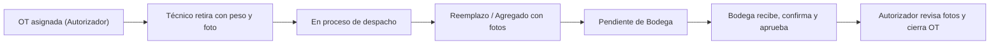

# Base de Datos del Contexto Actual de AFRISAN (`Esquema afrisan · 02/11/2026`)

## Estado al 08/11/2026

- **En Supabase:** modelo base `05` (30 tablas y 8 vistas) y la migración `07`.
- **Preparadas y probadas en PostgreSQL local, pendientes de aplicar en Supabase** (orden 08 → 09 → 10, comandos en [DESPLIEGUE.md](../03_CODIGO/DESPLIEGUE.md)):

| Migración | Qué agrega | Detalle |
| --- | --- | --- |
| [`08_Rectificacion_Pesajes.sql`](08_Rectificacion_Pesajes.sql) | Tabla `RectificacionPesaje`, vista `PesajeVigente` y bloqueo del cierre con correcciones pendientes | [Rectificaciones (P05)](../04_SEGUIMIENTO/MODULOS_2026_11_08/README.md) |
| [`09_Mantenedores_Bajas.sql`](09_Mantenedores_Bajas.sql) | Columna `Version` en `Cliente`, `Sucursales` y `Refrigerantes`, validaciones de desactivación y permisos de `BajaCilindro` | [Mantenedores y bajas](../03_CODIGO/MANTENEDORES_Y_BAJAS.md) |
| [`10_Costos_Limites.sql`](10_Costos_Limites.sql) | Tabla `TiposCambio`, precios y valoraciones en CLP/EUR/USD/UF y límites por gas | [Costos y límites](../03_CODIGO/COSTOS_Y_LIMITES.md) |

Después de 08–10 el esquema tiene **32 tablas y 9 vistas**. El
[diccionario](DICCIONARIO_ESQUEMA_AFRISAN.md) ya incluye las tres migraciones.
Certificados de disposición y la integración con el ERP siguen diferidos.

## 1. Instalación Vigente en Supabase: Esquema Único `afrisan` Sin Emisiones

Por definición de alcance del **02/11/2026** (`D-21` y `D-22`), la base de datos operativa de **AFRISAN** utiliza un único esquema **`afrisan`** en **PostgreSQL 16 (Supabase)** compuesto por **30 tablas relacionales y 8 vistas operativas**, retirando las tablas y columnas de emisiones de carbono (`CO₂e` / `GWP`), que quedan diferidas como módulo opcional futuro.

### Scripts vigentes del modelo actual (`02/11/2026`)

| Archivo SQL | Propósito y estado al `02/11/2026` |
| --- | --- |
| [`05_Crear_Afrisan_Sin_Emisiones.sql`](05_Crear_Afrisan_Sin_Emisiones.sql) | Instalador limpio del esquema `afrisan` (30 tablas, 8 vistas, funciones transaccionales, triggers y RLS) para instancias nuevas donde `afrisan` aún no existe. |
| [`06_Reemplazar_Esquemas_Por_Afrisan.sql`](06_Reemplazar_Esquemas_Por_Afrisan.sql) | Script transaccional ejecutado el `02/11/2026` para reemplazar los esquemas previos (`afrisan_actual`, `afrisan_bi`, `afrisan_bi_actual`) por el esquema único `afrisan` vacío. *(No volver a ejecutar sobre la base activa para no borrar registros).* |
| [`07_Habilitar_Persistencia.sql`](07_Habilitar_Persistencia.sql) | **Actualización aditiva aplicada en Supabase (`02/11/2026`):** agrega columnas de soporte para borradores (`HuellaCreacion`, `DatosBorrador`, `FotosBorrador`), crea y configura el login restringido `afrisan_api` (sin `SUPERUSER` ni `BYPASSRLS`) y habilita las políticas RLS `BackendConfiable`. |

- **Verificación de esquema y flujo sin emisiones:** [`SIN_EMISIONES_2026_11_02/README.md`](SIN_EMISIONES_2026_11_02/README.md) (140 comprobaciones en PGlite).
- **Verificación autenticada contra Supabase real (`SUP-01`):** [`../04_SEGUIMIENTO/SUPABASE_2026_11_02.md`](../04_SEGUIMIENTO/SUPABASE_2026_11_02.md) (TLS `VerifyFull`, 30 tablas, 8 vistas y RLS activo).
- **Activación de persistencia y reinicio de API (`G02`):** [`../03_CODIGO/PERSISTENCIA.md`](../03_CODIGO/PERSISTENCIA.md) y [`../04_SEGUIMIENTO/PERSISTENCIA_2026_11_02/README.md`](../04_SEGUIMIENTO/PERSISTENCIA_2026_11_02/README.md) (37 comprobaciones aprobadas).
- **Diccionario de datos vigente (columnas, tipos, PK, FK, CHECK, índices, triggers y permisos de la API, de 05 a 10):** [`DICCIONARIO_ESQUEMA_AFRISAN.md`](DICCIONARIO_ESQUEMA_AFRISAN.md). Se genera desde el SQL con `perl generar_diccionario.pl > DICCIONARIO_ESQUEMA_AFRISAN.md`.

---

## 2. Correspondencia de Tablas y Vistas con el Negocio (`AFRISAN_NUEVO`)

| Dominio / Necesidad operativa | Tablas y objetos en el esquema `afrisan` |
| --- | --- |
| **Roles y usuarios reales (5 roles)** | `Rol` (`Administrador`, `Jefatura`, `Autorizador`, `Bodega`, `Tecnico`) y `Usuario` (hash de contraseña, bloqueo temporal tras 5 intentos fallidos, versión de seguridad). Sin tabla `Permisos`. |
| **Clientes, sucursales y catálogo** | `Cliente`, `Sucursales` y `Refrigerantes`. |
| **Inventario físico y pesajes en gramos** | `Cilindros` (`CilindroQR` único, `Id_Refrigerante`, `TaraGr`, `Capacidadgr`), `Pesaje` (`Inicial`, `Despacho`, `Instalado`, `Retirado`, `Recepcion`), `EvidenciaPesaje` (metadatos del bucket privado `afrisan-evidencias` y `SHA256`), `CustodiaActual` e `HistorialCilindro`. |
| **Orden de Trabajo y retiro por Técnico** | `OrdenTrabajo` (`Id_Tecnico` y `Id_Autorizador` obligatorios, `Id_Publico` UUID), `DetalleOT` (`GrSolicitados`, `GrAutorizados`), `RetiroPrevisto` y `Despacho` + función transaccional `afrisan.retirar_cilindro`. |
| **Terreno, recepción y doble revisión** | `OperacionTerreno` (`Reemplazo` con cilindro instalado y retirado o `Agregado` solo con instalado), `RecepcionBodega`, `RevisionOT` (orden obligatorio `Bodega` → `Autorizador`) e `Incidencia`. |
| **Límites por sucursal y costos** | `LimiteSucursal` (semanal/mensual con bloqueo de edición por `Jefatura`), `LimiteSucursalHistorial`, `MedicionLimite`, `MedicionLimiteOperaciones`, `RevisionExceso`, `PreciosRefrigerantes` y `Costos`. |
| **Bajas, disposición Regener y auditoría** | `BajaCilindro`, `CertificadosDisposicion`, `CertificadosCilindros`, `EventoOT` y `Auditoria`. |
| **8 Vistas Operativas y de BI** | `Inventario`, `ResumenOT`, `PesajesRecepcion`, `LimitesVigentes`, `ExcesosRegistrados`, `CostosOperaciones`, `DisposicionesCertificadas` y `PedidoYEjecucion`. |

> **Acceso de la API:** `07_Habilitar_Persistencia.sql` otorga permisos y la política `BackendConfiable` al rol `afrisan_api` en 20 tablas. Las 10 tablas de límites, costos, disposición y bajas (`LimiteSucursal`, `LimiteSucursalHistorial`, `MedicionLimite`, `MedicionLimiteOperaciones`, `RevisionExceso`, `PreciosRefrigerantes`, `Costos`, `CertificadosDisposicion`, `CertificadosCilindros` y `BajaCilindro`) ya existen con sus reglas, pero la API aún no tiene acceso a ellas. Habrá que agregar los `GRANT` y la política cuando se implementen esos módulos.

---

## 3. Flujo Operativo e Integridad Transaccional

- **Unidades y precisión:** Todas las masas operativas (`TaraGr`, `Capacidadgr`, `PesoBrutoGr`, `GrSolicitados`, `GrAutorizados`) se almacenan en **gramos enteros (`1 kg = 1.000 g`)**. El contenido neto según pesaje equivale a `PesoBrutoGr - TaraGr`.
- **Seguridad en base de datos:** Las 30 tablas mantienen **Row Level Security (RLS)** activo y permisos revocados para `PUBLIC`, `anon` y `authenticated`. La API se conecta mediante el rol restringido `afrisan_api` y fija en cada transacción el actor autenticado mediante `set_config('afrisan.id_usuario', :id_usuario::text, true)`.
- **Antecedentes históricos (`01` a `04`):** Los archivos `01_Crear_Afrisan_Supabase.sql`, `02_MER_Completo_Afrisan_Nuevo.sql`, `03_Crear_Tablas_Sin_Datos.sql` y `04_Crear_Afrisan_Contexto_Actual.sql` se conservan únicamente como registro de evolución del modelo de datos; no deben ejecutarse sobre la instalación vigente. Lo mismo vale para [`TABLAS_PK_FK_TIPOS_MANUAL.md`](TABLAS_PK_FK_TIPOS_MANUAL.md), que describe el script `03` del 19/10/2026; el diccionario vigente es [`DICCIONARIO_ESQUEMA_AFRISAN.md`](DICCIONARIO_ESQUEMA_AFRISAN.md).
