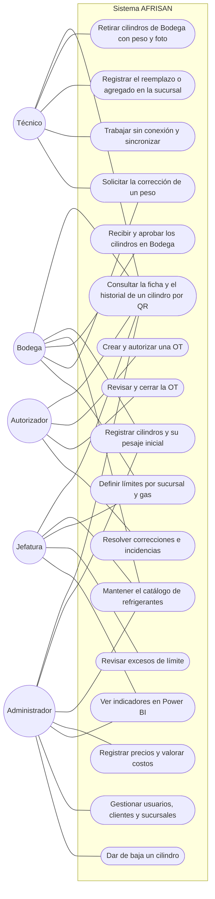
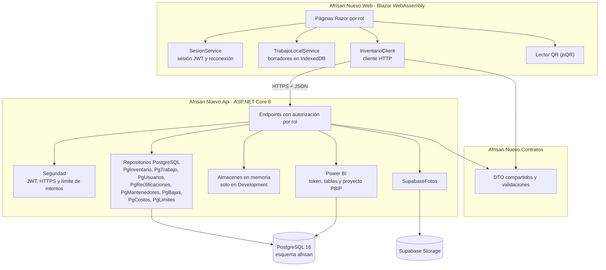
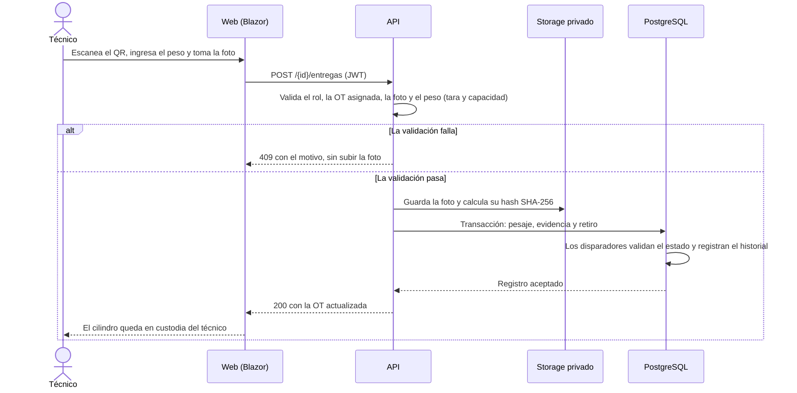
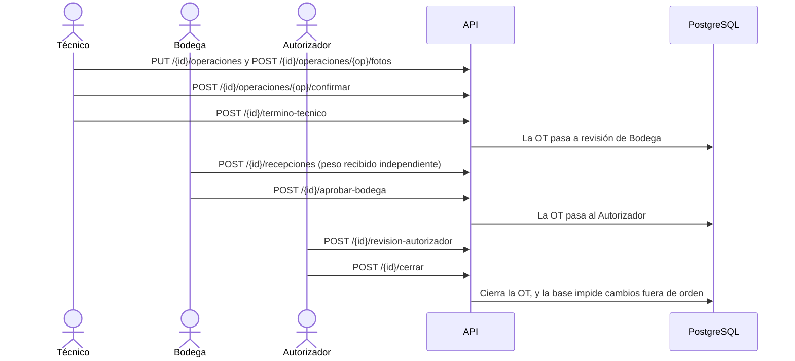
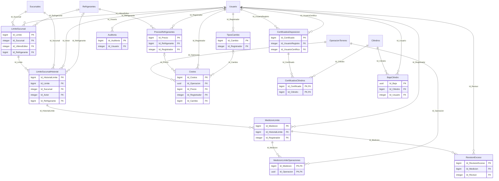

# Diagramas UML y modelo de datos vigente

Proyecto APT AFRISAN · Responsable: Dante Moya · Corte: 14/11/2026

Los diagramas describen la solución vigente (`AFRISAN_NUEVO`). Están escritos en Mermaid,
que GitHub dibuja al abrir este archivo. Los diagramas de la Fase 1 (vistas 4+1, componentes,
despliegue y MER) están en `Fase 1/Documentación del proyecto/` y corresponden al diseño
inicial, basado en la recarga de equipos.

## 1. Casos de uso

Mermaid no tiene un diagrama de casos de uso propio; se usa un diagrama de flujo con la
misma notación: actores a la izquierda y casos de uso dentro del límite del sistema.

Los permisos de cada caso de uso están en la [especificación de la API](../../../AFRISAN_NUEVO/03_CODIGO/API.md).

## 2. Componentes

## 3. Despliegue

El diagrama de despliegue está en la sección 6 del [README](../../../README.md). La API y la
web irán en Microsoft Azure (D-35); la base de datos y las fotos siguen en Supabase.

## 4. Secuencia: retiro de un cilindro desde Bodega

Rutas relativas a `/api/v1/ordenes-trabajo`.

## 5. Secuencia: de la operación en terreno al cierre de la OT

## 6. Modelo entidad-relación vigente

El modelo tiene 32 tablas en el esquema `afrisan` (PostgreSQL 16 en Supabase). Los diagramas
muestran solo las claves primarias (PK) y foráneas (FK); las columnas, los tipos, las reglas
CHECK, los índices y los disparadores están en el
[diccionario de datos](../../../AFRISAN_NUEVO/02_BASE_DATOS/DICCIONARIO_ESQUEMA_AFRISAN.md).
Las relaciones se dibujan como uno a muchos; `|o` indica que la clave foránea admite nulos.
Los diagramas se generaron desde el diccionario el 14/11/2026.

### 6.1 Operación (20 tablas)

```mermaid
erDiagram
    Rol {
        smallint Id_Rol PK
    }
    Usuario {
        integer Id_Usuario PK
        smallint Id_Rol FK
    }
    Cliente {
        integer Id_Cliente PK
    }
    Sucursales {
        integer Id_Sucursal PK
        integer Id_Cliente FK
    }
    Refrigerantes {
        bigint Id_Refrigerante PK
    }
    Cilindros {
        bigint Id_Cilindro PK
        bigint Id_Refrigerante FK
        integer Id_Sucursal FK
        integer Id_Tecnico FK
        uuid Id_UltimoPesaje FK
        integer Id_Registrador FK
    }
    OrdenTrabajo {
        bigint Id_OrdenTrabajo PK
        integer Id_Sucursal FK
        integer Id_Tecnico FK
        integer Id_Autorizador FK
    }
    DetalleOT {
        bigint Id_OrdenTrabajo PK,FK
        bigint Id_Refrigerante PK,FK
    }
    RetiroPrevisto {
        bigint Id_OrdenTrabajo PK,FK
        bigint Id_Cilindro PK,FK
    }
    Pesaje {
        uuid Id_Pesaje PK
        bigint Id_Cilindro FK
        bigint Id_OrdenTrabajo FK
        integer Id_Usuario FK
    }
    EvidenciaPesaje {
        uuid Id_Evidencia PK
        uuid Id_Pesaje FK
        integer Id_Usuario FK
    }
    Despacho {
        uuid Id_Despacho PK
        bigint Id_OrdenTrabajo FK
        bigint Id_Cilindro FK
        uuid Id_Pesaje FK
        integer Id_Tecnico FK
    }
    OperacionTerreno {
        uuid Id_Operacion PK
        bigint Id_OrdenTrabajo FK
        bigint Id_Instalado FK
        bigint Id_Retirado FK
        uuid Id_Despacho FK
        uuid Id_PesajeInstalado FK
        uuid Id_PesajeRetirado FK
        integer Id_Tecnico FK
        integer Id_EntregaInformadaPor FK
    }
    CustodiaActual {
        bigint Id_Cilindro PK,FK
        bigint Id_OrdenTrabajo FK
        integer Id_Tecnico FK
        uuid Id_Despacho FK
        uuid Id_Operacion FK
    }
    RecepcionBodega {
        uuid Id_Recepcion PK
        bigint Id_OrdenTrabajo FK
        bigint Id_Cilindro FK
        uuid Id_Operacion FK
        uuid Id_DespachoSinUso FK
        uuid Id_Pesaje FK
        integer Id_Bodeguero FK
    }
    RevisionOT {
        uuid Id_Revision PK
        bigint Id_OrdenTrabajo FK
        integer Id_Usuario FK
    }
    Incidencia {
        uuid Id_Incidencia PK
        bigint Id_OrdenTrabajo FK
        uuid Id_Operacion FK
        integer Id_Usuario FK
        integer Id_Revisor FK
    }
    HistorialCilindro {
        bigint Id_Historial PK
        bigint Id_Cilindro FK
        integer Id_Sucursal FK
        integer Id_Tecnico FK
        uuid Id_Pesaje FK
        integer Id_Usuario FK
    }
    EventoOT {
        bigint Id_Evento PK
        bigint Id_OrdenTrabajo FK
        integer Id_Usuario FK
    }
    RectificacionPesaje {
        uuid Id PK
        bigint Id_OrdenTrabajo FK
        uuid Id_Pesaje FK
        integer Id_Solicitante FK
        integer Id_Revisor FK
    }
    Rol ||--o{ Usuario : "Id_Rol"
    Cliente ||--o{ Sucursales : "Id_Cliente"
    Refrigerantes ||--o{ Cilindros : "Id_Refrigerante"
    Sucursales |o--o{ Cilindros : "Id_Sucursal"
    Usuario |o--o{ Cilindros : "Id_Tecnico"
    Pesaje |o--o{ Cilindros : "Id_UltimoPesaje"
    Usuario ||--o{ Cilindros : "Id_Registrador"
    Sucursales ||--o{ OrdenTrabajo : "Id_Sucursal"
    Usuario ||--o{ OrdenTrabajo : "Id_Tecnico"
    Usuario ||--o{ OrdenTrabajo : "Id_Autorizador"
    OrdenTrabajo ||--o{ DetalleOT : "Id_OrdenTrabajo"
    Refrigerantes ||--o{ DetalleOT : "Id_Refrigerante"
    OrdenTrabajo ||--o{ RetiroPrevisto : "Id_OrdenTrabajo"
    Cilindros ||--o{ RetiroPrevisto : "Id_Cilindro"
    Cilindros ||--o{ Pesaje : "Id_Cilindro"
    OrdenTrabajo |o--o{ Pesaje : "Id_OrdenTrabajo"
    Usuario ||--o{ Pesaje : "Id_Usuario"
    Pesaje ||--o{ EvidenciaPesaje : "Id_Pesaje"
    Usuario ||--o{ EvidenciaPesaje : "Id_Usuario"
    OrdenTrabajo ||--o{ Despacho : "Id_OrdenTrabajo"
    Cilindros ||--o{ Despacho : "Id_Cilindro"
    Pesaje ||--o{ Despacho : "Id_Pesaje"
    Usuario ||--o{ Despacho : "Id_Tecnico"
    OrdenTrabajo ||--o{ OperacionTerreno : "Id_OrdenTrabajo"
    Cilindros |o--o{ OperacionTerreno : "Id_Instalado"
    Cilindros |o--o{ OperacionTerreno : "Id_Retirado"
    Despacho |o--o{ OperacionTerreno : "Id_Despacho"
    Pesaje |o--o{ OperacionTerreno : "Id_PesajeInstalado"
    Pesaje |o--o{ OperacionTerreno : "Id_PesajeRetirado"
    Usuario ||--o{ OperacionTerreno : "Id_Tecnico"
    Usuario |o--o{ OperacionTerreno : "Id_EntregaInformadaPor"
    Cilindros ||--o{ CustodiaActual : "Id_Cilindro"
    OrdenTrabajo ||--o{ CustodiaActual : "Id_OrdenTrabajo"
    Usuario ||--o{ CustodiaActual : "Id_Tecnico"
    Despacho |o--o{ CustodiaActual : "Id_Despacho"
    OperacionTerreno |o--o{ CustodiaActual : "Id_Operacion"
    OrdenTrabajo ||--o{ RecepcionBodega : "Id_OrdenTrabajo"
    Cilindros ||--o{ RecepcionBodega : "Id_Cilindro"
    OperacionTerreno |o--o{ RecepcionBodega : "Id_Operacion"
    Despacho |o--o{ RecepcionBodega : "Id_DespachoSinUso"
    Pesaje ||--o{ RecepcionBodega : "Id_Pesaje"
    Usuario ||--o{ RecepcionBodega : "Id_Bodeguero"
    OrdenTrabajo ||--o{ RevisionOT : "Id_OrdenTrabajo"
    Usuario ||--o{ RevisionOT : "Id_Usuario"
    OrdenTrabajo ||--o{ Incidencia : "Id_OrdenTrabajo"
    OperacionTerreno |o--o{ Incidencia : "Id_Operacion"
    Usuario ||--o{ Incidencia : "Id_Usuario"
    Usuario |o--o{ Incidencia : "Id_Revisor"
    Cilindros ||--o{ HistorialCilindro : "Id_Cilindro"
    Sucursales |o--o{ HistorialCilindro : "Id_Sucursal"
    Usuario |o--o{ HistorialCilindro : "Id_Tecnico"
    Pesaje |o--o{ HistorialCilindro : "Id_Pesaje"
    Usuario ||--o{ HistorialCilindro : "Id_Usuario"
    OrdenTrabajo ||--o{ EventoOT : "Id_OrdenTrabajo"
    Usuario ||--o{ EventoOT : "Id_Usuario"
    OrdenTrabajo ||--o{ RectificacionPesaje : "Id_OrdenTrabajo"
    Pesaje ||--o{ RectificacionPesaje : "Id_Pesaje"
    Usuario ||--o{ RectificacionPesaje : "Id_Solicitante"
    Usuario |o--o{ RectificacionPesaje : "Id_Revisor"
```

### 6.2 Soporte, auditoría y bajas (12 tablas)

Las tablas de la operación aparecen solo con el nombre cuando se relacionan con estas.

