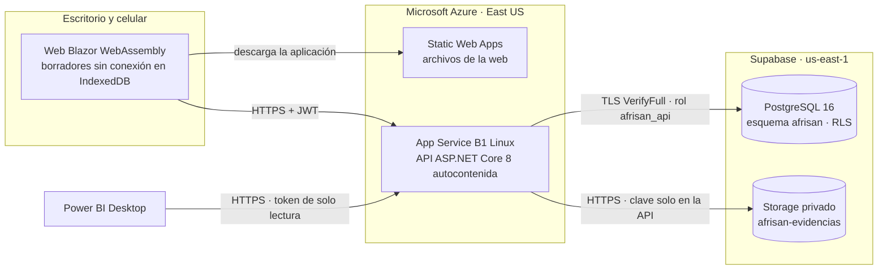

# AFRISAN · Sistema Integral de Gestión y Trazabilidad de Refrigerantes

Repositorio oficial del Proyecto Capstone (**PTY4614 — Duoc UC**) para la empresa **AFRISAN**.
Corte documental y técnico: **14 de noviembre de 2026**.

---

## 1. Descripción

**Qué hace.** Controla cada cilindro de gas refrigerante de AFRISAN, identificado con un
código QR, desde que sale de Bodega hasta que vuelve:

1. El Autorizador crea la orden de trabajo (OT) y asigna un técnico.
2. El técnico retira los cilindros de Bodega con peso y foto.
3. El técnico registra en la sucursal el reemplazo o el agregado del cilindro, con pesajes y fotos.
4. Bodega recibe y aprueba los cilindros que vuelven.
5. El Autorizador revisa la OT y la cierra.

Además incluye correcciones de peso con aprobación, gestión de usuarios, mantenedores,
bajas de cilindros, costos, límites por sucursal y gas, e indicadores en Power BI.

**A quién va dirigido.** A AFRISAN (Accesorios Frigoríficos Santiago Ltda., Cerrillos), que
mantiene equipos de refrigeración comercial e industrial en las sucursales de sus clientes.
Lo usan cinco roles: Técnico, Bodega, Autorizador, Jefatura y Administrador.

**Qué problema resuelve.** AFRISAN controlaba los cilindros con registros manuales, por lo
que no sabía con certeza dónde estaba cada envase, quién lo tenía ni cuánto gas salió y
volvió. La empresa asociaba esa falta de control a sobrecargas, pérdidas, robos y costos
altos. Lo que diferencia la solución y el valor que agrega se explican en la sección
5.6 del [informe final](<Fase 2/Evidencias Grupales/Informe_Final_Proyecto_APT_Afrisan_DM.docx>).

---

## 2. Tecnologías

| Capa | Tecnologías |
| --- | --- |
| Interfaz web (escritorio y celular) | Blazor WebAssembly (.NET 8), lector QR con jsQR, IndexedDB para los borradores sin conexión |
| API | ASP.NET Core 8 (Minimal API), autenticación JWT, contraseñas con `PasswordHasher` (PBKDF2), QRCoder, Swagger solo en desarrollo |
| Datos | PostgreSQL 16 en Supabase, Npgsql y EF Core, RLS en todas las tablas, rol restringido `afrisan_api` |
| Archivos | Supabase Storage, bucket privado `afrisan-evidencias` |
| Analítica | Power BI Desktop (proyecto PBIP, medidas DAX y Power Query) |
| Pruebas | xUnit, `Microsoft.AspNetCore.Mvc.Testing`, coverlet; baterías de integración sobre PostgreSQL embebido (PGlite) y Chromium |
| Integración y despliegue | GitHub Actions, Docker (`Dockerfile.api` y `Dockerfile.web` con nginx), GitHub Container Registry; destino Azure App Service y Static Web Apps (D-35) |
| Gestión | Scrum, Trello y Git/GitHub |

---

## 3. Ejecución local

**Requisitos:** .NET SDK 8 y .NET SDK 10. El SDK 10 abre la solución `.slnx` y el runtime 8
ejecuta la aplicación.

**Opción A: con Visual Studio.** Abrir **[`AFRISAN.slnx`](AFRISAN.slnx)** y ejecutar el perfil
**`AFRISAN NUEVO - AMBOS`** (`F5`). También se puede ejecutar en PowerShell:

```powershell
.\AFRISAN_NUEVO\03_CODIGO\Iniciar-Revision.ps1
```

La API queda en `http://localhost:5181` y la web en `http://localhost:5286/acceso`. Por
defecto la API usa PostgreSQL y Storage de Supabase, con credenciales en User Secrets
([configuración](AFRISAN_NUEVO/03_CODIGO/CONEXION_SUPABASE.md)).

**Opción B: sin Supabase (modo memoria, solo Development).** Sirve para revisar el sistema
con datos de prueba y las cinco cuentas de demostración, sin credenciales:

```powershell
$env:Persistencia__Modo = 'Memoria'
dotnet run --project AFRISAN_NUEVO/03_CODIGO/Afrisan.Nuevo.Api --launch-profile http
```

En otra terminal:

```powershell
dotnet run --project AFRISAN_NUEVO/03_CODIGO/Afrisan.Nuevo.Web
```

**Pruebas:** `dotnet test AFRISAN.slnx` (488 pruebas xUnit).

---

## 4. Integrantes y roles

| Integrante | Rol |
| --- | --- |
| **Dante Amaro Moya Negrete** (`da.moyan@duocuc.cl`) | En la Fase 1, Scrum Master de un equipo de tres. Desde el 16/10/2026 es el responsable único: asume los roles de Product Owner, Scrum Master, desarrollo y QA. Es autor de todo el desarrollo de `AFRISAN_NUEVO` y de la documentación de la Fase 2. |
| Carolina Ávila Medina | Fase 1: Product Owner; condujo la entrevista técnica con AFRISAN. |
| Yarek Larraguibel | Fase 1: participó en el acta de constitución y en el informe de Fase 1. |

---

## 5. Metodología

Metodología mixta, justificada en la sección 4 del informe final:

- **Fase 1 (planificación tradicional):** entrevista técnica, acta de constitución, backlog
  priorizado con MoSCoW, arquitectura 4+1 evaluada con ATAM, modelo de datos y plan de trabajo.
- **Fase 2 (Scrum adaptado a un desarrollador):** sprints con un objetivo verificable,
  backlog con criterios de aceptación, tablero en Trello y una retrospectiva por sprint.
  Cada incremento sigue el mismo ciclo: regla de negocio, datos, contrato, API, pantalla,
  guion de pruebas, corrección y documentación.

| Artefacto | Ubicación |
| --- | --- |
| Visión del producto, definición de hecho (DoD) y retrospectivas de la Fase 2 | [`14_Vision_DoD_y_Retrospectivas_Afrisan_DM.md`](<Fase 2/Evidencias Proyecto/Evidencias de documentación/14_Vision_DoD_y_Retrospectivas_Afrisan_DM.md>) |
| Product backlog y sprint backlog | `Fase 1/Documentación del proyecto/01_…` y `02_…`; plan y backlog de Fase 2 en `Evidencias de documentación/01_…` |
| Línea base del calendario (semanas oficiales, sprints e hitos) | [`16_Linea_Base_de_Planificacion_Afrisan_DM.md`](<Fase 2/Evidencias Proyecto/Evidencias de documentación/16_Linea_Base_de_Planificacion_Afrisan_DM.md>) |
| Tablero por sprints | [`TRELLO_2026_11_08/Tablero_AFRISAN.md`](AFRISAN_NUEVO/04_SEGUIMIENTO/TRELLO_2026_11_08/Tablero_AFRISAN.md) |
| Registro de decisiones y cambios (D-01 a D-38) | [`DECISIONES_Y_PENDIENTES.md`](AFRISAN_NUEVO/04_SEGUIMIENTO/DECISIONES_Y_PENDIENTES.md) |
| Retrospectivas de la Fase 1 | `Fase 1/Documentación del proyecto/09_Revision_de_Retrospectivas_Afrisan_DM.docx` |

---

## 6. Arquitectura de la solución

Tres proyectos .NET 8 y un proyecto de pruebas:

- **`Afrisan.Nuevo.Web`:** aplicación Blazor WebAssembly que usan el escritorio y el celular.
  No guarda credenciales de la base ni claves de Storage.
- **`Afrisan.Nuevo.Contratos`:** datos (DTO) que comparten la web y la API.
- **`Afrisan.Nuevo.Api`:** API REST que concentra las reglas de negocio, la autorización por
  rol y el acceso a PostgreSQL y Storage.
- **`Afrisan.Nuevo.Pruebas`:** pruebas xUnit.

Diagrama de despliegue (publicado en Azure el 15/11/2026: web en https://ambitious-field-0d951cb0f.6.azurestaticapps.net y API en https://afrisan-api-dm.azurewebsites.net; ver [DESPLIEGUE.md](AFRISAN_NUEVO/03_CODIGO/DESPLIEGUE.md)):



| Documento | Ubicación |
| --- | --- |
| Arquitectura 4+1 y evaluación ATAM | `Fase 1/Documentación del proyecto/Arquitectura/` |
| Diagramas UML (casos de uso, secuencia, componentes) y modelo entidad-relación vigente | [`15_Diagramas_UML_y_Modelo_de_Datos_Afrisan_DM.md`](<Fase 2/Evidencias Proyecto/Evidencias de documentación/15_Diagramas_UML_y_Modelo_de_Datos_Afrisan_DM.md>) |
| Diccionario de datos (32 tablas y 9 vistas) | [`DICCIONARIO_ESQUEMA_AFRISAN.md`](AFRISAN_NUEVO/02_BASE_DATOS/DICCIONARIO_ESQUEMA_AFRISAN.md) |
| Especificación de la API | [`API.md`](AFRISAN_NUEVO/03_CODIGO/API.md) |
| Manual técnico de despliegue y Docker | [`DESPLIEGUE.md`](AFRISAN_NUEVO/03_CODIGO/DESPLIEGUE.md) |

---

## 7. Estructura del repositorio

| Carpeta | Contenido principal |
| --- | --- |
| [`Fase 1/Evidencias Individuales`](<Fase 1/Evidencias Individuales>) | Autoevaluación de competencias (`1.1`), diario de reflexión (`1.2`) y autoevaluación de Fase 1 (`1.3`) de Dante Moya (`MOYA_DANTE_...`). Versiones originales en `Historico/`. |
| [`Fase 1/Evidencias Grupales`](<Fase 1/Evidencias Grupales>) | Presentación de Fase 1 (`Presentación Proyecto.pptx`), pauta formativa (`1.4`), guía de definición del proyecto (`1.5`) y pauta sumativa (`1.6`). Versiones originales en `Historico/`. |
| [`Fase 1/Documentación del proyecto`](<Fase 1/Documentación del proyecto>) | Acta de constitución (`00`), product backlog (`01`), sprint backlog (`02`), plan de trabajo e hitos (`03`), carta Gantt (`04`), informe de Fase 1 (`05`), plan de comunicación (`06`), entrevista (`07`), matriz RACI (`08`), retrospectivas (`09`), `Sprint 0/`, `Arquitectura/` y documentos originales en `Historico/`. |
| [`Fase 2/Evidencias Individuales`](<Fase 2/Evidencias Individuales>) | Diario de reflexión de Fase 2 (`MOYA_DANTE_2.1_APT122_DiarioReflexionFase2.docx`). |
| [`Fase 2/Evidencias Grupales`](<Fase 2/Evidencias Grupales>) | **Informe final del Proyecto APT**, guías del estudiante `2.4` y `2.6`, y pautas sumativas `2.5` (avance) y `2.7` (final). |
| [`Fase 2/Evidencias Proyecto`](<Fase 2/Evidencias Proyecto>) | `Presentación Proyecto.pptx`; `Evidencias de documentación/` con los documentos `01` a `03` y `05` a `16`, `ANEXOS/` y la entrega original del avance (`Entrega_Avance_2026_10_22/`); `Evidencias de sistema Aplicación/` y `Base de datos/`. |
| [`Fase 3`](<Fase 3>) | Estructura preparada para `Evidencias Individuales/` (`3.1`) y `Evidencias Grupales/` (presentación final). |
| [`AFRISAN_NUEVO`](AFRISAN_NUEVO/README.md) | Reglas de negocio (`01_NEGOCIO`), scripts SQL del esquema `afrisan` (`02_BASE_DATOS`), solución .NET 8 (`03_CODIGO`) y evidencias de pruebas y seguimiento (`04_SEGUIMIENTO`). |

El [mapa documental](MAPA_DOCUMENTAL.md) ordena todos los documentos por etapa del ciclo de
vida. También están el [manual de usuario](AFRISAN_NUEVO/03_CODIGO/MANUAL_USUARIO.md), el
[manual de operación](AFRISAN_NUEVO/03_CODIGO/MANUAL_OPERACION.md), la
[guía de contribución](CONTRIBUTING.md) y las [notas de versión](CHANGELOG.md).

---

## 8. Estado técnico

1. **Base de datos:** el esquema único `afrisan` está instalado en Supabase con 32 tablas y
   9 vistas (`05`, `07` y, desde el 09/11/2026, las migraciones `08` a `10`), rol restringido
   `afrisan_api`, TLS `VerifyFull` y RLS en todas las tablas
   ([registro](AFRISAN_NUEVO/04_SEGUIMIENTO/SUPABASE_2026_11_09.md)). La migración `11`
   se aplicó en Supabase el 15/11/2026, después de probarla en PostgreSQL embebido; la API
   de esta versión la necesita para consultar las OT.
2. **Operación:** OT por reemplazo o agregado físico, fotos en Storage privado y borradores
   sin conexión en IndexedDB. Bodega puede devolver una OT al técnico, el Autorizador puede
   anular una OT sin trabajos, el peso se compara entre etapas con 200 g de tolerancia y el
   cilindro retirado vuelve «Vacío» hasta su recarga (D-39 a D-43, a partir del
   [recorrido completo del 14/11](AFRISAN_NUEVO/04_SEGUIMIENTO/CORRECCIONES_2026_11_14/README.md)).
3. **Módulos del 08/11/2026:** gestión de usuarios, correcciones de peso con aprobación,
   mantenedores, bajas de cilindros, costos en CLP, EUR, USD y UF, límites por sucursal y
   gas, y Power BI. Sus reglas las definió el responsable del proyecto y falta validarlas
   con AFRISAN.
4. **Seguridad:** fuera de desarrollo, la API exige HTTPS y HSTS, no publica Swagger y
   limita los intentos de inicio de sesión. `dotnet list package --vulnerable` no reporta
   hallazgos.
5. **Power BI:** lee las tablas desde la API con un token de solo lectura de 30 días, y la
   web descarga el proyecto ya conectado ([POWER_BI.md](AFRISAN_NUEVO/03_CODIGO/POWER_BI.md)).
6. **Pendiente:**
   - revisar en el despliegue de Azure el caso que depende de él (CDP-39, Android; CDP-64 pasó 46 de 46 el 17/11, pero queda fallido hasta resolver DEF-11) y llevar las fotos a Supabase Storage (DEF-11) ([guía](AFRISAN_NUEVO/03_CODIGO/DESPLIEGUE.md));
   - pruebas en Android (G05) y aceptación con usuarios (G09); la contraparte de AFRISAN no
     está disponible desde el 11/11 (D-36);
   - actualizar el informe en Power BI Desktop (CDP-57) y publicarlo;
   - Defontana y certificados, diferidos.

---

## 9. Pruebas y calidad

| Tipo | Cómo ejecutar | Resultado |
| --- | --- | --- |
| Unitarias e integración HTTP (xUnit) | `dotnet test AFRISAN.slnx` | 488 pruebas aprobadas al 18/11/2026; 32 % de cobertura de líneas (medida el 12/11) |
| Integración sobre PostgreSQL embebido y navegador | `AFRISAN_NUEVO/04_SEGUIMIENTO/MODULOS_2026_11_08/Validar-Modulos.ps1` (requiere Node.js) | Resultados JSON fechados en `AFRISAN_NUEVO/04_SEGUIMIENTO/` |
| Correcciones del recorrido del 14/11 (migración `11`) | `node AFRISAN_NUEVO/04_SEGUIMIENTO/CORRECCIONES_2026_11_14/validar_correcciones.mjs` | 40 comprobaciones correctas el 15/11/2026 |
| Recorrido completo contra Supabase (CDP-67) | `node AFRISAN_NUEVO/04_SEGUIMIENTO/CORRECCIONES_2026_11_14/recorrido_supabase.mjs` (API local contra Supabase) | 33 comprobaciones correctas el 15/11/2026 |
| Power BI contra Supabase (CDP-54 a CDP-57) | `node AFRISAN_NUEVO/04_SEGUIMIENTO/POWER_BI_2026_11_15/validar_powerbi_supabase.mjs` (API local contra Supabase) | 62 comprobaciones correctas el 15/11/2026, incluido el consumo por sucursal |
| Integración continua | [`.github/workflows/ci.yml`](.github/workflows/ci.yml) | Compila y ejecuta xUnit en cada push a `main` |
| Plan de pruebas | `Evidencias de documentación/06_…` y `07_…` | 72 casos (CDP-01 a CDP-72): 59 aprobados, 12 pendientes y 1 bloqueado; recorrido completo del 14/11, repetido en Supabase el 15/11, y 14 defectos registrados |

La capa PostgreSQL se prueba con las baterías de integración y no entra en la cobertura de
xUnit. Por eso la cobertura todavía no llega a la meta del 80 % del acta.

---

## 10. Historial del avance

- **Fase 1:** se entregó desde el repositorio del equipo
  [`Tormenta-Yarek/AFRISAN-APT`](https://github.com/Tormenta-Yarek/AFRISAN-APT).
- **Avance de Fase 2:** se entregó desde [`dantemoya/Afrisan`](https://github.com/dantemoya/Afrisan),
  que hoy tiene el mismo contenido que este repositorio.
- **Consolidación:** este repositorio se consolidó el 08/11/2026 en un solo commit (`c2cc46b`).
  El avance anterior quedó en carpetas con fecha:
  - validaciones y resultados en `AFRISAN_NUEVO/04_SEGUIMIENTO/<TEMA>_<FECHA>/`, desde el 20/10/2026;
  - decisiones desde la D-01 en [`DECISIONES_Y_PENDIENTES.md`](AFRISAN_NUEVO/04_SEGUIMIENTO/DECISIONES_Y_PENDIENTES.md);
  - versiones originales de las entregas en `Historico/` y `Entrega_Avance_2026_10_22/`.

  Desde esa fecha, cada avance se registra como un commit separado.

---

## Licencia

Código y documentación propiedad de Dante Amaro Moya Negrete, con todos los derechos
reservados. El repositorio es público solo para su evaluación académica; cualquier otro uso
requiere autorización por escrito (ver [LICENSE](LICENSE)).
